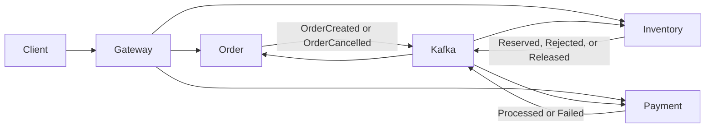

# Order Saga Platform

An event-driven order platform that reserves stock, takes a payment, and confirms the order. When a step fails, the services compensate by releasing the reservation. A gateway checks the caller's token and forwards it. An operations endpoint explains, in plain English, which saga step failed.



Happy path: `OrderCreated` → `InventoryReserved` → `PaymentProcessed` → order `CONFIRMED`.

Payment failure: method `declined` emits `PaymentFailed`. The order becomes `COMPENSATING` and emits `OrderCancelled`. Inventory releases the hold and emits `InventoryReleased`, and the order becomes `CANCELLED`. A decline never captures funds, so there is no processor refund. Releasing stock is the compensation.

Stock failure: unknown SKU or quantity above available stock emits `InventoryRejected`. The order is `CANCELLED` immediately. Nothing was reserved, so no cancel event is published.

## Tech stack

- Java 21, Spring Boot 3.5, Maven Wrapper
- Spring Cloud Gateway and Keycloak (OAuth2/OIDC resource servers)
- PostgreSQL and Flyway, one database per service
- Kafka choreography with a transactional outbox
- Redis cache for product reads
- Spring AI (OpenAI-compatible) with a built-in fallback narrator
- Testcontainers, JUnit 5, springdoc-openapi, Actuator, OpenTelemetry

## Key features

- Place an order, read it with its saga history, read a product, and read the payment result.
- Database per service: `orderdb`, `inventorydb`, and `paymentdb`.
- Idempotent consumers. Each service stores processed event ids and ignores duplicates.
- Optimistic locking on product stock. A failed lock throws and Kafka retries.
- `POST /api/ops/ask` explains one order from its recorded events. Without an API key the answer comes from a deterministic narrator.
- Structured JSON logs, health and metrics, and traces exported to Jaeger.

## Run locally

Stop any other stack that already binds 5432, 6379, 8080, 8081, 8082, 8083, 8180, 9092, 4318, or 16686.

```bash
docker compose up --build
```

Compose is the supported local run. It starts Postgres, Redis, Kafka, Jaeger, Keycloak (realm imported from `keycloak/order-saga-realm.json`), and the four applications. Keycloak's local admin and the database user are demo defaults (`admin` / `admin`, `saga` / `saga`). The API user is `demo` / `password`.

Wait until Keycloak answers, then request a token:

```bash
curl -s -X POST "http://localhost:8180/realms/order-saga/protocol/openid-connect/token" \
  -d "client_id=order-api" \
  -d "username=demo" \
  -d "password=password" \
  -d "grant_type=password"
```

Copy `access_token` into `TOKEN`. Jaeger is at http://localhost:16686. Swagger UI is on each servlet service, for example http://localhost:8081/swagger-ui.html. The gateway listens on http://localhost:8080.

To run one service from the shell, start the dependencies with Compose and then:

```bash
./mvnw -pl order-service -am spring-boot:run
./mvnw -pl inventory-service -am spring-boot:run
./mvnw -pl payment-service -am spring-boot:run
./mvnw -pl api-gateway -am spring-boot:run
```

`k8s/` is a starting sketch (Deployments, Services, ConfigMap, probes). It expects images such as `order-service:local`. It does not mount the Keycloak realm. Compose is what you should run.

Optional model settings live in `.env.example`. Compose works without a `.env`. Set `SPRING_AI_MODEL_CHAT=openai` and `OPENAI_API_KEY` only when you want a real explanation. `OPENAI_BASE_URL` and `OPENAI_MODEL` override the endpoint and model. With the default `none`, the app starts and the narrator answers.

## API examples

Create an order through the gateway:

```bash
curl -s -X POST http://localhost:8080/api/orders \
  -H "Authorization: Bearer $TOKEN" \
  -H "Content-Type: application/json" \
  -d '{"sku":"WIDGET","quantity":1,"paymentMethod":"card"}'
```

```json
{
  "id": "6f0c2a4e-1b7a-4c2e-9d1a-2a9b0e6c4d11",
  "customer": "demo",
  "sku": "WIDGET",
  "quantity": 1,
  "amount": 0.00,
  "paymentMethod": "card",
  "status": "PENDING",
  "events": []
}
```

The amount stays `0.00` until inventory prices the reservation. Poll the order:

```bash
curl -s http://localhost:8080/api/orders/6f0c2a4e-1b7a-4c2e-9d1a-2a9b0e6c4d11 \
  -H "Authorization: Bearer $TOKEN"
```

```json
{
  "id": "6f0c2a4e-1b7a-4c2e-9d1a-2a9b0e6c4d11",
  "customer": "demo",
  "sku": "WIDGET",
  "quantity": 1,
  "amount": 25.00,
  "paymentMethod": "card",
  "status": "CONFIRMED",
  "events": [
    {"eventId": "…", "type": "OrderCreated", "createdAt": "2026-11-18T09:00:00Z"},
    {"eventId": "…", "type": "InventoryReserved", "createdAt": "2026-11-18T09:00:01Z"},
    {"eventId": "…", "type": "PaymentProcessed", "createdAt": "2026-11-18T09:00:01Z"}
  ]
}
```

Seeded catalog: `WIDGET` is 25.00 with stock 100, `GADGET` is 10.00 with stock 1.

```bash
curl -s http://localhost:8080/api/products/WIDGET -H "Authorization: Bearer $TOKEN"
```

```json
{"sku":"WIDGET","name":"Widget","price":25.00,"available":99}
```

```bash
curl -s http://localhost:8080/api/payments/6f0c2a4e-1b7a-4c2e-9d1a-2a9b0e6c4d11 \
  -H "Authorization: Bearer $TOKEN"
```

```json
{"orderId":"6f0c2a4e-1b7a-4c2e-9d1a-2a9b0e6c4d11","status":"PROCESSED","amount":25.00,"method":"card","reason":null,"createdAt":"2026-11-18T09:00:01Z"}
```

Force a decline. The payment method `declined` fails the payment step and releases stock:

```bash
curl -s -X POST http://localhost:8080/api/orders \
  -H "Authorization: Bearer $TOKEN" \
  -H "Content-Type: application/json" \
  -d '{"sku":"WIDGET","quantity":1,"paymentMethod":"declined"}'
```

Ask why it failed:

```bash
curl -s -X POST http://localhost:8080/api/ops/ask \
  -H "Authorization: Bearer $TOKEN" \
  -H "Content-Type: application/json" \
  -d '{"orderId":"ORDER_ID","question":"Why did this order fail?"}'
```

```json
{
  "answer": "The payment step failed, and the reserved inventory was released. Events: OrderCreated, InventoryReserved, PaymentFailed, OrderCancelled, InventoryReleased.",
  "source": "fallback"
}
```

`source` is `openai` when a model is configured and returns text. A missing product or order is an RFC 7807 problem (`https://orders.sahidanwar.dev/problems/not-found`). Validation failures use `…/problems/validation`.

## Design decisions

Choreography keeps each service independent. There is no saga orchestrator process. The trade-off is that the flow is spread across listeners, so the order service stores the full event history and the ask endpoint reads that history instead of inferring steps.

The outbox is written in the same database transaction as the business change, then a scheduler publishes to Kafka. That avoids XA across Postgres and Kafka. Delivery is at-least-once. Consumers dedupe on `event_id`. Payment and inventory events can arrive before the order service has applied the reservation. The order service records the early payment event and applies it when the reservation lands, so the saga does not stall.

Each service owns its schema. Compose runs one Postgres server and creates three databases so a laptop can boot the stack. Production should use separate instances and credentials. The same split is why Flyway locations are `classpath:db/order`, `classpath:db/inventory`, and `classpath:db/payment`: a shared test classpath must not mix the scripts.

Money is `BigDecimal` and `numeric(19,2)`. Inventory sets the line amount as price times quantity. The order stores that amount when the reservation arrives.

Keycloak issues tokens for `http://localhost:8180/realms/order-saga`. Services validate that issuer, but they download the JWKS from `http://keycloak:8080/...` inside the Compose network. `issuer-uri` is not set, because that would make the services fetch keys from `localhost` inside the containers. The gateway checks the JWT itself and forwards the `Authorization` header. It does not use a session `TokenRelay` filter, which would drop a bearer token sent by curl.

Tests use an HMAC decoder (`profile test`) so the suite does not start Keycloak. The secret is a test-only value. Production profile `!test` uses the Keycloak JWKS.

The narrator is the default. Spring AI is created only when `spring.ai.model.chat=openai`. The model is told to use the recorded events and not invent steps. If the call fails, the API still returns the narrator and `source` stays `fallback`.

## Testing

Unit tests cover the narrator, stock reserve and release, and the decline rule (`declined` is rejected, other methods are approved). They do not need Docker.

`platform-tests` starts the gateway and the three services against Testcontainers Postgres, Kafka, and Redis. The suite places a `WIDGET` order and waits until it is `CONFIRMED` and stock has dropped. It places a `declined` order and waits until stock is restored and the history contains `PaymentFailed` and `InventoryReleased`. It orders two `GADGET`s (only one is in stock) and expects `InventoryRejected` with stock unchanged. JWTs are signed with the same HMAC secret as the test profile.

```bash
./mvnw -B verify
```

GitHub Actions runs that command on every push. `verify` needs a Docker daemon for Testcontainers.

## Possible future improvements

- A real processor capture, with a refund event when a charge succeeded and a later step fails.
- Separate Postgres instances, a schema registry, and `SKIP LOCKED` on the outbox claim.
- Check that the caller owns the order before returning it.
- More than one partition once ordering by order id is kept on the key.
- Turn the Kubernetes sketch into a deployed environment, including the realm import and image publishing.
